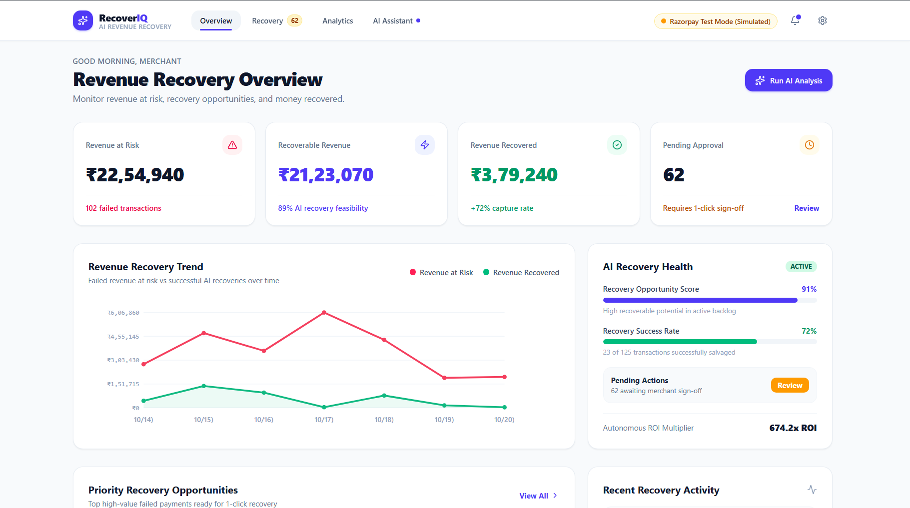
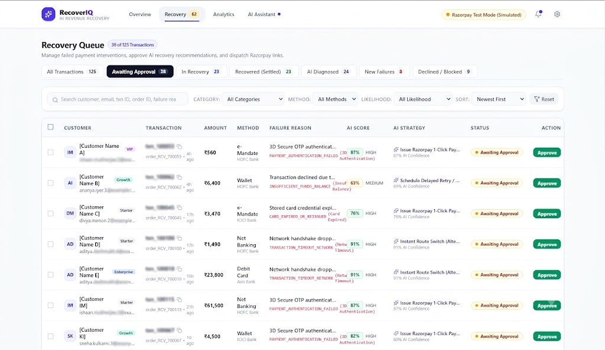
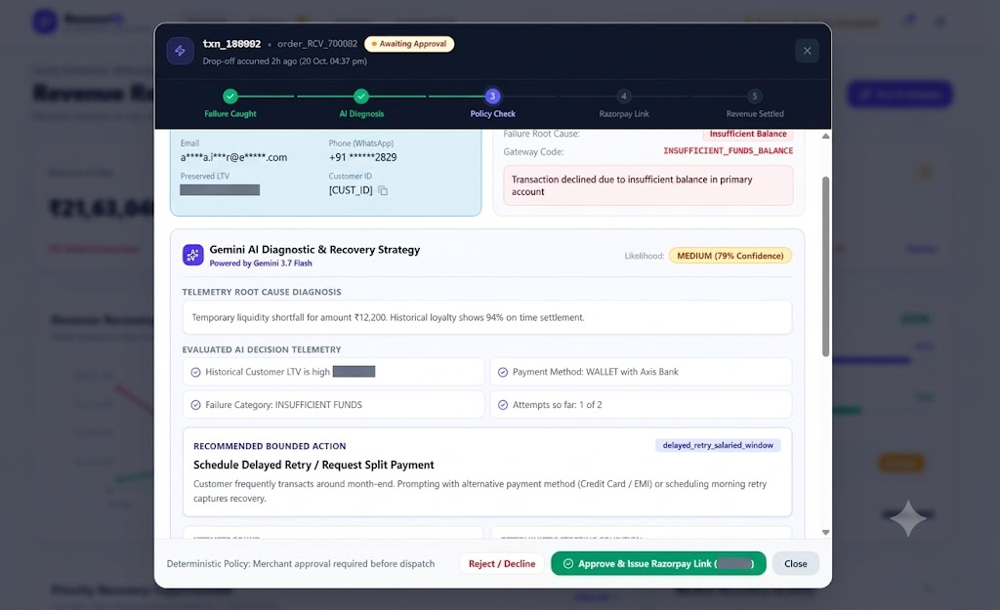
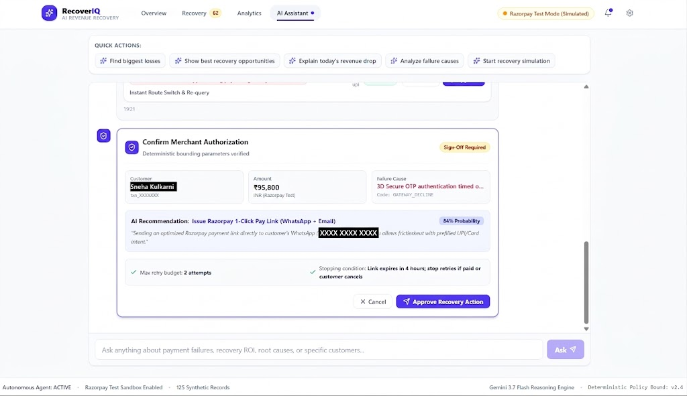

# RecoverIQ
### AI Revenue Recovery Agent

> Built for the Razorpay Hackathon · Powered by Google Gemini · Runs on Razorpay Test Mode

---

## Problem

Every day, merchants lose revenue not because customers don't want to pay — but because payments fail for reasons that are often fixable.

Bank downtimes, 3DS authentication timeouts, expired cards, network glitches, insufficient-funds windows, and mandate failures silently erode revenue. Most payment failures are treated as final. They aren't.

The status quo:
- Merchants have no visibility into *why* a payment failed
- No intelligent prioritisation of which failures are worth chasing
- Manual follow-ups are slow, inconsistent, and unscalable
- No guardrails prevent inappropriate or repeated recovery attempts

**RecoverIQ** turns failed payments from a write-off into a recoverable revenue opportunity.

---

## Solution

RecoverIQ is an agentic AI revenue recovery loop that runs end-to-end — from failure detection to payment settlement — with a human merchant in the approval seat.

```
  Failed Payment
       │
       ▼
① DETECT   — Revenue at risk surfaces in the Recovery Queue
       │
       ▼
② DIAGNOSE — Gemini AI analyses the root cause (failure code, customer tier,
             payment method, attempt history, bank signals)
       │
       ▼
③ PRIORITISE — AI assigns a Recovery Likelihood (HIGH / MEDIUM / LOW / NONE)
              and a confidence score (0–100%)
       │
       ▼
④ RECOMMEND — AI selects the optimal intervention:
              Smart Retry · Payment Link · Alt Method · Delayed Retry · Concierge
       │
       ▼
⑤ POLICY CHECK — Deterministic guardrails enforce:
                 • Max retry attempts
                 • Amount thresholds
                 • Fraud zero-tolerance (auto-blocked, no override)
                 • Merchant-defined approval rules
       │
       ▼
⑥ MERCHANT APPROVAL — No money moves without explicit merchant sign-off
       │
       ▼
⑦ EXECUTE — Razorpay Test Mode API creates a real payment link
            (rzp_test_ keys only — live keys are rejected at startup)
       │
       ▼
⑧ AUDIT — Every action (AI, Policy, Merchant, Razorpay) is written to an
          immutable audit trail with actor, timestamp, and outcome
```

---

## Key Features

| Feature | Description |
|---|---|
| **AI Revenue Risk Detection** | Surfaces failed transactions with calculated revenue-at-risk scores in real time |
| **AI Root Cause Analysis** | Gemini AI diagnoses each failure: root cause, contributing factors, and a customer message draft |
| **Recovery Probability Scoring** | AI confidence score (0–100%) + likelihood tier (HIGH / MEDIUM / LOW / NONE) per transaction |
| **Recovery Recommendations** | AI selects from 6 action types mapped to the specific failure pattern |
| **Policy Guardrails** | Deterministic rule engine enforces retry limits, amount thresholds, and fraud blocks before any action |
| **Merchant Approval Gate** | All money-movement actions require explicit merchant approval — no autonomous execution |
| **Razorpay Test Mode Integration** | Authenticated Razorpay API (`v1/payment_links`) — only `rzp_test_` keys are accepted |
| **Audit Trail** | Append-only log of every event: `SYSTEM`, `GEMINI_AI`, `POLICY_ENGINE`, `MERCHANT`, `RAZORPAY_GATEWAY` |
| **Analytics Dashboard** | Recovery rates, revenue recovered, ROI multiplier, failure category breakdowns, and trend charts |
| **Graceful Failure Handling** | If Gemini API is unavailable, the system falls back to deterministic heuristics — nothing breaks |
| **AI Conversational Assistant** | Chat-based recovery assistant powered by Gemini with structured, actionable responses |
| **Policy Sandbox** | Merchants can tune recovery policy (retry limits, thresholds, discount caps) and preview impact |

---

## Screenshots

### Revenue Recovery Dashboard

The overview dashboard summarizes revenue at risk, recoverable revenue, recovered revenue, pending approvals, recovery trends, and AI recovery health.



### Recovery Queue

The Recovery Queue allows merchants to review failed transactions, inspect payment failure reasons, view AI recovery scores, and approve recommended recovery strategies.



### AI Diagnosis and Recovery Strategy

RecoverIQ analyzes payment failures using Gemini AI, evaluates transaction telemetry, identifies likely root causes, and recommends a bounded recovery action.



### Human-in-the-Loop Merchant Authorization

Before a recovery action is dispatched, the merchant reviews the AI recommendation, retry limits, stopping conditions, and policy requirements.



> The screenshots use simulated Razorpay Test Mode data. Personal-looking customer information has been blurred for public portfolio use.

---

## Tech Stack

| Layer | Technology |
|---|---|
| **Frontend** | React 19, TypeScript, Vite 6 |
| **Styling** | Tailwind CSS v4 (via `@tailwindcss/vite`) |
| **Animations** | Motion (Framer Motion v12), canvas-confetti |
| **Icons** | Lucide React |
| **Backend** | Node.js, Express 4, TypeScript (`tsx` for dev) |
| **AI** | Google Gemini via `@google/genai` SDK (`gemini-2.0-flash` / `gemini-2.5-flash`) |
| **Payment Gateway** | Razorpay REST API — Test Mode only (`v1/payment_links`) |
| **Build** | Vite (frontend) + esbuild (backend bundle) |
| **Runtime** | Node.js (ESM), `bun` lockfile |

---

## Architecture

```
Browser (React SPA)
    │  Vite proxy → localhost:3000
    │
    ▼
Express Server (server.ts · port 3000)
    │
    ├─── GET  /api/transactions          → dataStore (in-memory, synthetic dataset)
    ├─── POST /api/transactions/:id/diagnose → geminiService → Gemini AI API
    ├─── POST /api/transactions/:id/approve  → razorpayService → Razorpay Test API
    ├─── POST /api/transactions/:id/simulate-payment → razorpayService (settlement)
    ├─── POST /api/assistant/chat        → geminiService (conversational AI)
    ├─── GET  /api/analytics             → dataStore (computed metrics)
    ├─── GET  /api/audit-trail           → dataStore (append-only audit log)
    ├─── GET|POST /api/policy-config     → dataStore (merchant policy rules)
    └─── POST /api/webhook/razorpay      → razorpayService (webhook + HMAC verify)
    │
    ├── server/geminiService.ts
    │       Structured JSON diagnosis via Gemini (schema-enforced output)
    │       Conversational assistant with full analytics context injection
    │       Deterministic fallback if API key is absent
    │
    ├── server/razorpayService.ts
    │       Strict test-key guard (rejects rzp_live_ at startup)
    │       Razorpay payment link creation (v1/payment_links)
    │       Webhook ingestion with HMAC-SHA256 signature verification
    │       Simulation mode when Razorpay is not configured
    │
    └── server/dataStore.ts
            Synthetic dataset generator (125 transactions, 7 failure categories)
            In-memory transaction store with filtering + search
            Policy engine (deterministic rule evaluation)
            Audit log (append-only, actors: SYSTEM / GEMINI_AI / POLICY_ENGINE / MERCHANT / RAZORPAY_GATEWAY)
```

**Key design decisions:**

- **Approval gate is non-negotiable.** `executeRecoveryWorkflow()` checks `requireApprovalForMoneyMovement` and merchant sign-off before any Razorpay API call is made.
- **Fraud is zero-tolerance.** Transactions categorised as `fraud_risk_flag` are policy-blocked and cannot be overridden by the merchant.
- **AI output is schema-enforced.** Gemini responses are constrained to a typed JSON schema — no freeform text parsing in the recovery path.
- **Graceful degradation.** If `GEMINI_API_KEY` is not set, the system generates deterministic heuristic diagnoses and the full UI remains functional.

---

## Running Locally

### Prerequisites

- Node.js 18+ (or Bun)
- A [Gemini API key](https://aistudio.google.com/app/apikey) (free tier works)
- Razorpay Test Mode keys from [dashboard.razorpay.com](https://dashboard.razorpay.com/app/keys) *(optional — simulation mode is active without them)*

### Setup

```bash
# 1. Clone the repository
git clone https://github.com/Sai-Sri-Krishna/RecoverIQ.git
cd RecoverIQ

# 2. Install dependencies
npm install
# or: bun install

# 3. Configure environment variables
cp .env.example .env
# Edit .env and fill in your keys (see Environment Variables below)

# 4. Start the development server
npm run dev
```

The app will be available at **http://localhost:3000**

> The Express server serves both the API (`/api/*`) and the Vite-compiled React frontend. No separate frontend dev server is needed — the Vite proxy is embedded.

### Production Build

```bash
npm run build   # Builds frontend (Vite) + backend bundle (esbuild)
npm start       # Runs the production bundle
```

---

## Environment Variables

Copy `.env.example` to `.env` and configure:

| Variable | Required | Description |
|---|---|---|
| `GEMINI_API_KEY` | Recommended | Google Gemini API key for AI diagnosis and the conversational assistant |
| `RAZORPAY_KEY_ID` | Optional | Razorpay Test Mode key ID — must begin with `rzp_test_` |
| `RAZORPAY_KEY_SECRET` | Optional | Razorpay Test Mode key secret |
| `RAZORPAY_WEBHOOK_SECRET` | Optional | Webhook signing secret for HMAC-SHA256 signature verification |
| `APP_URL` | Optional | Public URL of the hosted app (used for Razorpay callback URLs) |

> ⚠️ **Live mode keys are rejected.** The application enforces a strict guard at startup — any `RAZORPAY_KEY_ID` not starting with `rzp_test_` will be refused and the system will fall back to simulation mode.

> Secret values must never be committed to version control. Only variable *names* are listed here.

---

## Demo

RecoverIQ ships with a **synthetic dataset generator** that creates 125 realistic failed payment transactions across 7 failure categories (bank downtime, 3DS authentication failure, insufficient funds, expired card, network timeout, fraud risk flag, and mandate issues) and 4 customer tiers (VIP, Enterprise, Growth, Starter).

All Razorpay interactions use **Test Mode** exclusively:

- Payment links are created against the `rzp_test_` API
- No real money is charged at any point
- Settlement is simulated via the `/api/transactions/:id/simulate-payment` endpoint

The dataset can be reseeded at any time from the **Settings** panel inside the app.

---

## API Endpoints

| Method | Path | Description |
|---|---|---|
| `GET` | `/api/health` | Service health check |
| `GET` | `/api/transactions` | List transactions (filterable by status, category, method, likelihood) |
| `GET` | `/api/transactions/:id` | Get single transaction |
| `POST` | `/api/transactions/:id/diagnose` | Trigger Gemini AI diagnosis |
| `POST` | `/api/transactions/batch-diagnose` | Batch AI diagnosis (up to 15) |
| `POST` | `/api/transactions/:id/approve` | Merchant approval → Razorpay execution |
| `POST` | `/api/transactions/:id/reject` | Merchant rejection → mark permanently failed |
| `POST` | `/api/transactions/:id/simulate-payment` | Simulate customer payment settlement |
| `POST` | `/api/transactions/batch-approve` | Batch merchant approval (up to 20) |
| `POST` | `/api/transactions/batch-recover` | Batch settlement simulation |
| `GET` | `/api/analytics` | Aggregated analytics summary |
| `GET` | `/api/audit-trail` | Audit log (filterable by transaction, actor, event type) |
| `GET` | `/api/policy-config` | Get current merchant policy configuration |
| `POST` | `/api/policy-config` | Update merchant policy configuration |
| `POST` | `/api/assistant/chat` | AI conversational assistant |
| `POST` | `/api/transactions/reset` | Reseed synthetic dataset |
| `POST` | `/api/webhook/razorpay` | Razorpay webhook ingestion endpoint |
| `GET` | `/api/razorpay/status` | Razorpay configuration and connection status |

---

*RecoverIQ — Turning payment failures into recovered revenue.*
